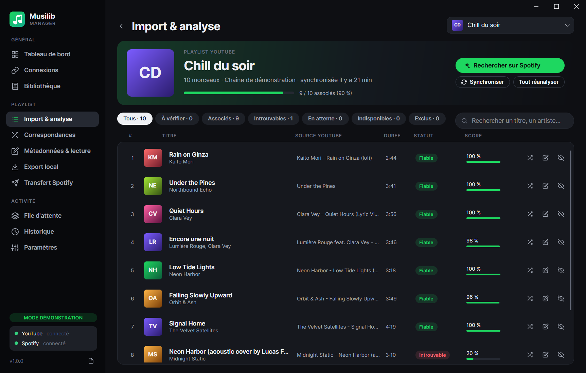
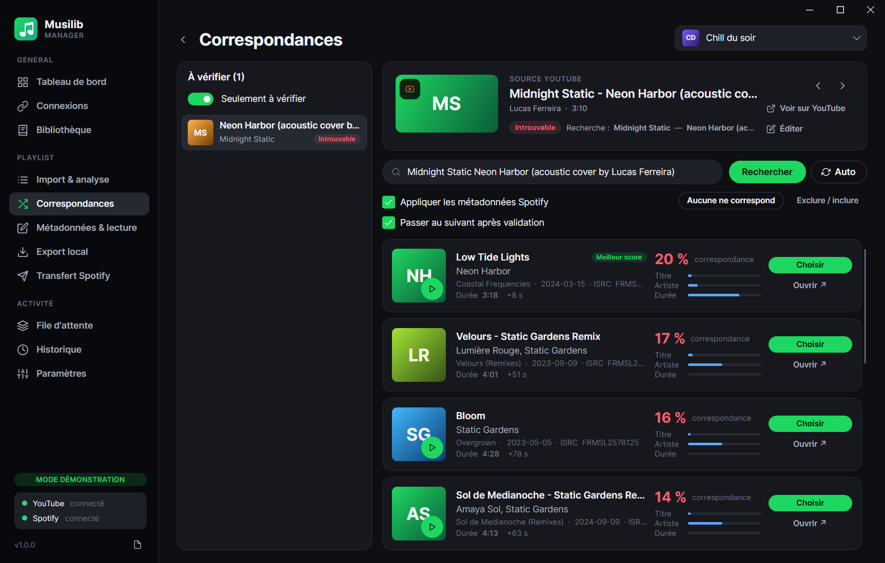
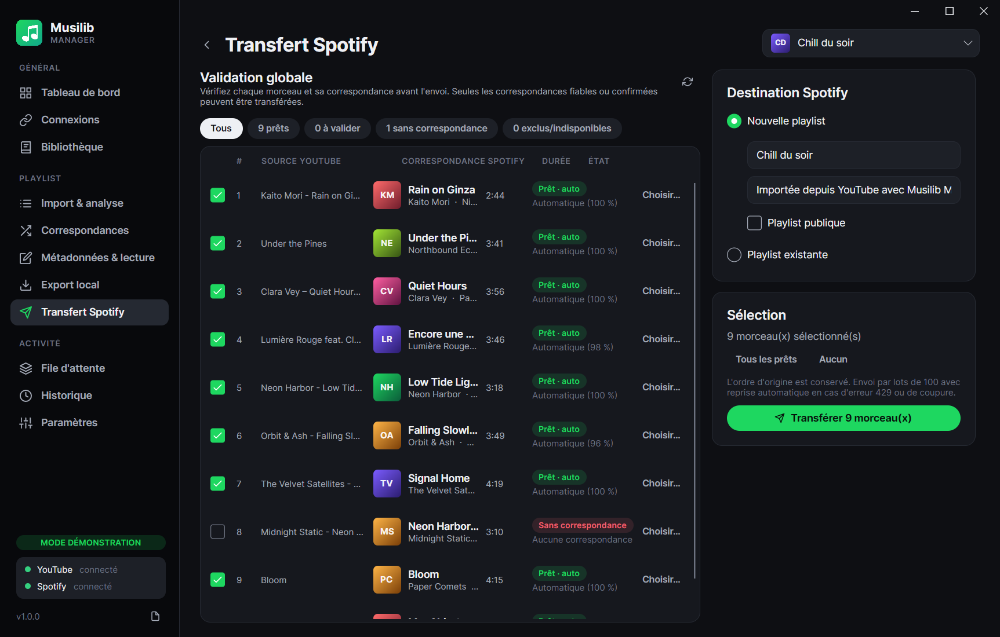
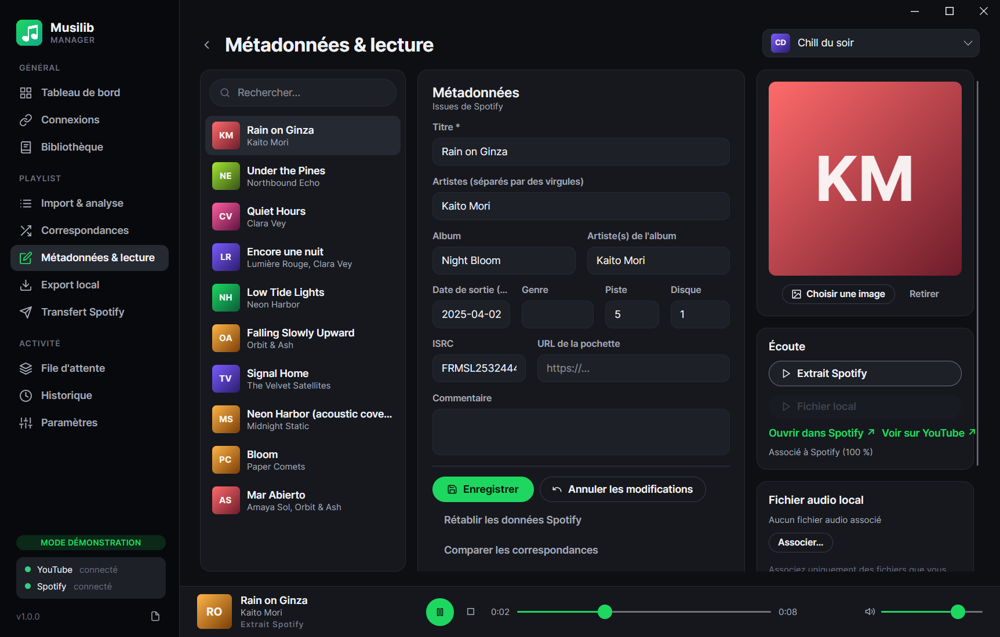
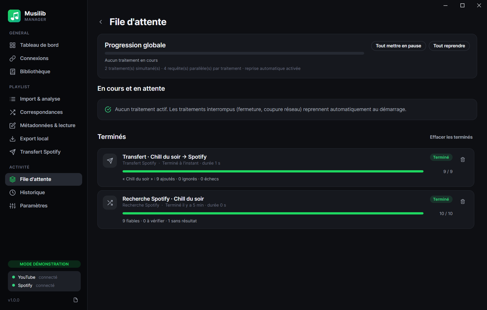

# Musilib Manager

[](https://github.com/SebastienSCochet/Musilib/actions/workflows/ci.yml)

Application de bureau (Windows, .NET 10, Avalonia UI) pour **importer vos playlists YouTube**, les **enrichir avec les métadonnées Spotify**, **exporter localement les fichiers audio que vous possédez** (organisés et taggués) et **transférer votre sélection vers une playlist Spotify**.



---

## Sommaire

1. [Fonctionnalités](#fonctionnalités)
2. [Démarrage rapide (mode démonstration)](#démarrage-rapide-mode-démonstration)
3. [Prérequis](#prérequis)
4. [Configuration de l'API YouTube](#configuration-de-lapi-youtube-google-cloud)
5. [Configuration de l'API Spotify](#configuration-de-lapi-spotify)
6. [Compilation, exécution et tests](#compilation-exécution-et-tests)
7. [Publication d'un exécutable Windows autonome](#publication-dun-exécutable-windows-autonome)
8. [Architecture](#architecture)
9. [Fonctionnement détaillé](#fonctionnement-détaillé)
10. [Sécurité et données](#sécurité-et-données)
11. [Conformité et limites des plateformes](#conformité-et-limites-des-plateformes)
12. [Dépannage](#dépannage)

---

## Fonctionnalités

| Écran | Ce qu'il permet |
|---|---|
| **Tableau de bord** | Statistiques globales (playlists, morceaux associés, à vérifier, transferts, appels API évités par le cache, vidéos indisponibles), playlists récentes, derniers traitements, activité. |
| **Connexions** | Saisie des identifiants (ID client Google, client secret, clé API facultative, Client ID Spotify, port de redirection), connexion/déconnexion OAuth, test de connexion, aide pas à pas. |
| **Bibliothèque** | Import par URL/ID, liste de **vos playlists YouTube** (privées et « J'aime » incluses) avec miniature et nombre de vidéos, resynchronisation, suppression. |
| **Import & analyse** | Tableau des morceaux dans l'ordre d'origine : titre/artistes déduits, source YouTube, durée, statut (fiable, confirmé, à vérifier, introuvable, indisponible, exclu), score ; filtres, recherche, lancement/relance de l'analyse Spotify avec progression en direct. |
| **Correspondances** | File des morceaux à vérifier, comparaison côte à côte source YouTube ↔ résultats Spotify (pochette, titre, artistes, album, date, ISRC, durée et écart, score détaillé titre/artiste/durée), écoute de l'extrait, recherche manuelle (filtres `track:`, `artist:`, `isrc:`), « aucune ne correspond », exclusion. |
| **Métadonnées & lecture** | Édition du titre, des artistes, de l'album, de l'artiste d'album, de la date de sortie, du genre, des numéros de piste/disque, de l'ISRC, du commentaire et de la pochette (image locale ou URL) ; rétablissement des données Spotify ; association d'un fichier audio local ; lecteur intégré (extrait Spotify ou fichier local). |
| **Export local** | Association automatique de vos fichiers par analyse d'un dossier, association manuelle, prévisualisation (copie, conversion, doublon, conflit), organisation Artiste/Album, renommage « Artiste - Titre », tags ID3/Vorbis/MP4, pochette intégrée, playlist M3U8, conversion FFmpeg facultative. |
| **Transfert Spotify** | Nouvelle playlist (publique/privée) ou playlist existante modifiable, **écran de validation globale** de tous les morceaux et de leurs correspondances, sélection/exclusion, confirmation, envoi ordonné par lots de 100, rapport détaillé (ajoutés, ignorés et pourquoi, échecs), reprise. |
| **File d'attente** | Progression globale et par traitement, élément en cours, pause/reprise/annulation, nettoyage. |
| **Historique** | Journal filtrable de toutes les opérations (imports, correspondances, éditions, exports, transferts, connexions). |
| **Paramètres** | Mode démo, thème sombre/clair, concurrence, retries, Retry-After maximal, reprise automatique, cache, seuils de correspondance, marché Spotify, valeurs d'export par défaut, chemin FFmpeg, emplacements des données. |

<table>
<tr>
<td></td>
<td></td>
</tr>
<tr>
<td></td>
<td></td>
</tr>
</table>

---

## Démarrage rapide (mode démonstration)

Le mode démonstration permet d'utiliser **toute l'interface sans aucun compte** : playlists, artistes et titres sont **fictifs**, YouTube et Spotify sont simulés localement, une base SQLite séparée (`musilib-demo.db`) est utilisée et des fichiers audio de démonstration sont générés pour tester l'export.

```powershell
dotnet run --project src/Musilib.Desktop -- --demo
# ou, après publication :
MusilibManager.exe --demo
```

Le mode démo peut aussi être activé durablement dans **Paramètres → Mode démonstration** (redémarrage proposé).

Pour tester l'export en démo : **Export local → Associer depuis un dossier…** puis choisir `%LOCALAPPDATA%\Musilib\demo-music`.

---

## Prérequis

- Windows 10 (1809+) ou Windows 11, x64 ou ARM64.
- [SDK .NET 10](https://dotnet.microsoft.com/download) pour compiler (inutile pour l'exécutable publié, qui est autonome).
- Visual Studio 2022 17.14+/2026, JetBrains Rider ou VS Code (C# Dev Kit) — facultatif.
- **FFmpeg** — facultatif, uniquement pour convertir des fichiers lors de l'export ([ffmpeg.org](https://ffmpeg.org/download.html)). Musilib ne le redistribue pas.

---

## Configuration de l'API YouTube (Google Cloud)

Musilib lit vos playlists avec la portée minimale **`youtube.readonly`**.

1. Ouvrez la [Google Cloud Console](https://console.cloud.google.com/) et créez un projet.
2. **API et services → Bibliothèque** : activez **YouTube Data API v3**.
3. **Écran de consentement OAuth** : type *Externe*, renseignez le nom de l'application, puis ajoutez votre compte Google dans **Utilisateurs test** (tant que l'application n'est pas publiée/validée par Google).
4. **Identifiants → Créer des identifiants → ID client OAuth** → type **Application de bureau**.
5. Dans Musilib, écran **Connexions** : collez l'**ID client** et le **code secret du client**, cliquez **Enregistrer**, puis **Se connecter avec Google**.
   - Aucune URI de redirection n'est à déclarer : Musilib utilise une redirection locale `http://127.0.0.1:<port libre>/callback` (flux « loopback » recommandé par Google pour les applications de bureau, avec PKCE).
   - Google exige le code secret pour les clients « application de bureau » ; il est **chiffré** (DPAPI) et n'apparaît jamais dans les fichiers de configuration.
6. *(Facultatif)* Créez une **clé API** restreinte à YouTube Data API v3 pour importer des **playlists publiques** sans vous connecter.

**Quota** : 10 000 unités/jour par défaut. Un import coûte environ 2 unités par tranche de 50 vidéos (`playlistItems.list` + `videos.list`). En cas de quota épuisé, le traitement est **mis en pause** et peut être repris le lendemain (réinitialisation à minuit, heure du Pacifique).

---

## Configuration de l'API Spotify

Musilib utilise le flux **Authorization Code + PKCE** (aucun secret client) avec les portées minimales :
`playlist-read-private playlist-read-collaborative playlist-modify-private playlist-modify-public`.

1. Connectez-vous au [Spotify Developer Dashboard](https://developer.spotify.com/dashboard) et créez une application (API cochée : **Web API**).
2. Dans **Redirect URIs**, ajoutez exactement l'URI affichée dans Musilib (par défaut **`http://127.0.0.1:5543/callback`**).
   Spotify n'accepte plus `localhost` : utilisez bien `127.0.0.1`. Si vous changez le port dans Musilib, mettez l'URI à jour.
3. Copiez le **Client ID** dans Musilib (**Connexions**), **Enregistrer**, puis **Se connecter à Spotify**.
4. En **mode développement** (applications non validées par Spotify) :
   - ajoutez votre compte dans **User Management** (5 utilisateurs maximum) ; un compte Premium est requis pour le propriétaire de l'application depuis 2026 ;
   - la recherche est limitée à **10 résultats par requête** (valeur par défaut de Musilib, réglable dans les Paramètres pour les applications en « extended quota »).

Musilib utilise les endpoints en vigueur depuis la migration de février 2026 : `GET /search`, `GET /me`, `GET /me/playlists`, `POST /me/playlists`, `POST /playlists/{id}/items`, `GET /playlists/{id}/items`.

---

## Compilation, exécution et tests

```powershell
git clone https://github.com/SebastienSCochet/Musilib.git
cd Musilib

dotnet build Musilib.sln                       # compilation complète (0 avertissement)
dotnet run --project src/Musilib.Desktop       # exécution (mode normal)
dotnet run --project src/Musilib.Desktop -- --demo
dotnet test                                    # 130 tests automatisés
```

Dans Visual Studio : ouvrir `Musilib.sln`, définir **Musilib.Desktop** comme projet de démarrage, F5.

La base SQLite est **créée et migrée automatiquement** au premier lancement.

### Configuration sans secret

`src/Musilib.Desktop/appsettings.json` contient uniquement des valeurs par défaut non sensibles (endpoints, portées, seuils). Les réglages modifiés dans l'application sont enregistrés dans `%APPDATA%\Musilib\settings.json`. Toute valeur peut aussi être fournie par variable d'environnement préfixée `MUSILIB_` (ex. `MUSILIB_Musilib__Spotify__ClientId`), prise en compte tant qu'aucun `settings.json` utilisateur n'existe.

---

## Publication d'un exécutable Windows autonome

```powershell
./scripts/publish.ps1                 # tests + publication win-x64 + archive ZIP
./scripts/publish.ps1 -Runtime win-arm64 -SkipTests
scripts\publish.cmd                   # équivalent depuis cmd.exe
```

Résultat : `artifacts/publish/win-x64/MusilibManager.exe` (fichier unique self-contained, runtime .NET inclus, ~50 Mo) accompagné de `appsettings.json`, ainsi que `artifacts/MusilibManager-<version>-win-x64.zip`.

---

## Architecture

Clean Architecture en cinq projets (dépendances orientées vers le domaine) :

```
Musilib.Desktop  ──►  Musilib.Infrastructure  ──►  Musilib.Application  ──►  Musilib.Domain
 (Avalonia, MVVM)      (SQLite, HTTP, OAuth,         (cas d'usage, moteur       (entités, règles
                        TagLib, NAudio, FFmpeg,       de traitement, ports)       métier pures)
                        démo)
Musilib.Tests (xUnit, Moq) ──► Domain, Application, Infrastructure
```

| Projet | Contenu |
|---|---|
| **Domain** | Entités (`Playlist`, `Track`, `TrackMetadata`, `SpotifyCandidate`, `Job`, `HistoryEntry`), `MatchScorer` (score et décision), `YouTubeTitleParser`, `TextNormalizer`, `StringSimilarity`, `FileNameSanitizer`. Aucune dépendance. |
| **Application** | Ports (`IYouTubeClient`, `ISpotifyClient`, `IAuthService`, `ISecureStore`, dépôts, `IAudioMetadataService`, `IAudioConverter`, `IAudioPlayer`…), services (`PlaylistImportService`, `MatchingService`, `TrackEditingService`, `TransferService`, `ExportService`, `LocalLibraryService`, `DashboardService`), moteur `JobEngine` + gestionnaires de traitements. |
| **Infrastructure** | SQLite (Microsoft.Data.Sqlite, WAL, migrations), clients YouTube Data API v3 et Spotify Web API (`HttpClientFactory`), `RetryHandler`, OAuth PKCE + listener loopback, stockage DPAPI, TagLibSharp, FFmpeg, cache d'images, lecteur NAudio, fournisseurs de démonstration. |
| **Desktop** | Avalonia 11.3 (Fluent, thème sombre/clair), MVVM (CommunityToolkit.Mvvm, bindings compilés), DI (`Microsoft.Extensions.DependencyInjection`), Serilog. |

Chaque fournisseur externe est derrière une interface : remplacer YouTube/Spotify, la persistance ou le lecteur ne touche ni au domaine ni à l'interface.

**Dépendances principales** : .NET 10, Avalonia 11.3.23, CommunityToolkit.Mvvm 8.4.2, Microsoft.Extensions.* 10.0, Microsoft.Data.Sqlite 10.0, Serilog 4.4, TagLibSharp 2.3, NAudio 2.2.1, xUnit 2.9.3, Moq 4.20.

---

## Fonctionnement détaillé

### Import YouTube
- Pagination complète (`maxResults=50` + `nextPageToken`), durées récupérées par lots de 50 vidéos.
- **Ordre d'origine conservé** (position séquentielle).
- Vidéos **supprimées**, **privées** ou **indisponibles** détectées et signalées (aucune recherche Spotify inutile n'est lancée pour elles).
- Import **idempotent** : une resynchronisation conserve correspondances et métadonnées éditées, met à jour l'ordre, ajoute les nouveaux éléments et marque les éléments retirés.
- Sauvegarde par lots de 50 : aucune perte en cas d'interruption.

### Correspondances Spotify
- Analyse du titre YouTube (« Artiste - Titre (Official Video) », chaînes « - Topic »/« VEVO », `feat.`/`ft.`, titres entre guillemets).
- Requêtes de la plus précise à la plus large (`track:"…" artist:"…"`, puis texte libre), arrêt dès qu'une correspondance fiable est trouvée.
- **Score** (0–100 %) : titre 50 %, artistes 30 %, durée 20 % (Levenshtein + similarité par ensembles de mots, pénalité si version différente : live, remix, acoustic…, ISRC identique = preuve forte).
- **Décision** : *Fiable* seulement si score ≥ 85 % **et** aucun autre résultat différent à moins de 7 points (un single et sa version album, même ISRC, ne sont pas considérés comme rivaux) ; *À vérifier* sinon ; *Introuvable* sous 50 %. **Une correspondance incertaine n'est jamais validée silencieusement** et n'est jamais transférée sans votre choix. Seuils réglables.
- Jusqu'à 10 candidats conservés par morceau pour la comparaison ; toutes les décisions et modifications sont enregistrées.

### Moteur de traitement
- File d'attente **persistée dans SQLite** (tables `Jobs` et `JobItems`).
- Nombre de **traitements simultanés** et de **requêtes parallèles** par traitement configurables.
- Progression globale et individuelle, élément en cours, **pause, reprise et annulation propres**.
- **Reprise après fermeture ou plantage** : un traitement resté « en cours » est remis en file au démarrage ; les éléments déjà traités sont ignorés (statut par élément).
- Erreurs **par morceau** (le traitement continue) ; interruption automatique après 5 échecs consécutifs (coupure réseau), reprise manuelle ensuite.
- **Retry avec backoff exponentiel + jitter** sur 408/429/5xx et erreurs réseau, **respect de `Retry-After`** ; si l'attente demandée dépasse le maximum configuré, le traitement passe en pause.
- **Cache des recherches Spotify** (30 jours par défaut) et déduplication des traitements identiques : aucun appel API inutile.

### Transfert Spotify
- Écran de validation globale, sélection fine, confirmation récapitulative.
- Envoi **séquentiel par lots de 100** (limite de l'API) dans l'ordre d'origine.
- L'identifiant de la playlist créée est sauvegardé **avant** le premier ajout : une reprise ne recrée jamais la playlist et n'ajoute jamais deux fois un morceau.
- Lot refusé (URI invalide…) : envoi unitaire pour isoler l'élément fautif ; **succès partiels** détaillés dans le rapport.
- Option « ignorer les morceaux déjà présents » pour les playlists existantes.

### Export local
- Sources : **uniquement vos fichiers** (association automatique par tags ou nom de fichier, ou manuelle).
- Destination organisée (aucune, Artiste, Artiste/Album, Album), nom **« Artiste - Titre »**, caractères interdits et noms réservés Windows (`CON`, `LPT1`…) neutralisés, longueur limitée.
- Écriture des tags (ID3v2.3 pour le MP3, Vorbis, MP4, RIFF) et de la pochette.
- **Doublons** détectés (tags/ISRC identiques à la destination, même fichier source sélectionné deux fois) ; **conflits** : ignorer, conserver les deux (« (2) »), remplacer.
- **Original jamais modifié** : copie dans un fichier temporaire, tags écrits sur la copie, puis renommage atomique.
- Conversion FFmpeg uniquement si un format cible différent est choisi ; sans FFmpeg, l'export conserve le format d'origine.
- Playlist **M3U8** (chemins relatifs, ordre d'origine).

---

## Sécurité et données

| Élément | Emplacement | Protection |
|---|---|---|
| Base de données | `%LOCALAPPDATA%\Musilib\musilib.db` (`musilib-demo.db` en démo) | WAL + `synchronous=FULL` |
| Jetons OAuth, client secret Google, clé API | `%LOCALAPPDATA%\Musilib\secrets\*.bin` | **DPAPI** (compte Windows courant) ; AES-GCM + fichier de clé `0600` hors Windows |
| Paramètres | `%APPDATA%\Musilib\settings.json` | aucun secret |
| Journaux | `%LOCALAPPDATA%\Musilib\logs\musilib-AAAAMMJJ.log` (14 jours) | masquage automatique des jetons, codes, secrets et clés |
| Cache d'images | `%LOCALAPPDATA%\Musilib\cache\images` | — |

- Aucun secret dans le code source ni dans `appsettings.json`.
- Renouvellement automatique et thread-safe des jetons ; un 401 déclenche un unique rafraîchissement ; un `invalid_grant` supprime les jetons et demande une reconnexion.
- La clé API YouTube est transmise par en-tête (`X-goog-api-key`), jamais dans l'URL.
- Révocation du jeton Google à la déconnexion.

---

## Conformité et limites des plateformes

- **Musilib ne télécharge jamais d'audio depuis YouTube ou Spotify** : leurs API ne fournissent pas de fichiers audio téléchargeables et leurs conditions d'utilisation l'interdisent. L'export local porte exclusivement sur des fichiers que vous possédez (CD rippés, achats, téléchargements explicitement autorisés).
- La lecture se limite aux **extraits fournis par Spotify** (`preview_url`, absent pour de nombreux titres/applications) et à vos **fichiers locaux**.
- Le bouton « Voir sur YouTube » ouvre simplement la vidéo dans votre navigateur.
- Spotify (mode développement) : 5 utilisateurs, recherche limitée à 10 résultats, lecture des éléments d'une playlist réservée aux playlists dont vous êtes propriétaire ou collaborateur — d'où la proposition, pour les transferts, des seules playlists modifiables.
- La lecture audio intégrée (NAudio / Media Foundation) est disponible sous Windows.

---

## Dépannage

| Symptôme | Solution |
|---|---|
| « Configuration incomplète » | Renseignez et **enregistrez** les identifiants dans **Connexions**. |
| Spotify : `INVALID_CLIENT: Invalid redirect URI` | L'URI déclarée dans le Dashboard doit être identique à celle affichée (`http://127.0.0.1:<port>/callback`). |
| Spotify : 403 « Accès refusé » | Ajoutez votre compte dans *User Management* de l'application (mode développement). |
| Google : « Accès bloqué / application non validée » | Ajoutez votre compte dans les *Utilisateurs test* de l'écran de consentement. |
| Le port 5543 est occupé | Changez le port dans **Connexions** et mettez à jour l'URI dans le Dashboard Spotify. |
| « Quota YouTube atteint » | Le traitement est en pause ; reprenez-le le lendemain depuis la **File d'attente**. |
| Conversion désactivée | Installez FFmpeg ou indiquez `ffmpeg.exe` dans **Paramètres**. |
| Analyse détaillée d'un problème | Bouton « fichier » en bas de la barre latérale → dossier des journaux. |

---

## Structure du dépôt

```
Musilib.sln
Directory.Build.props / Directory.Packages.props   (versions centralisées)
src/
  Musilib.Domain/          entités et règles métier
  Musilib.Application/     cas d'usage, ports, moteur de traitement
  Musilib.Infrastructure/  SQLite, API, OAuth, médias, démo
  Musilib.Desktop/         application Avalonia (Views, ViewModels, Styles, Controls)
tests/
  Musilib.Tests/           tests xUnit (domaine, services, moteur, HTTP, API, persistance, OAuth)
scripts/
  publish.ps1 / publish.cmd
docs/screenshots/
```
